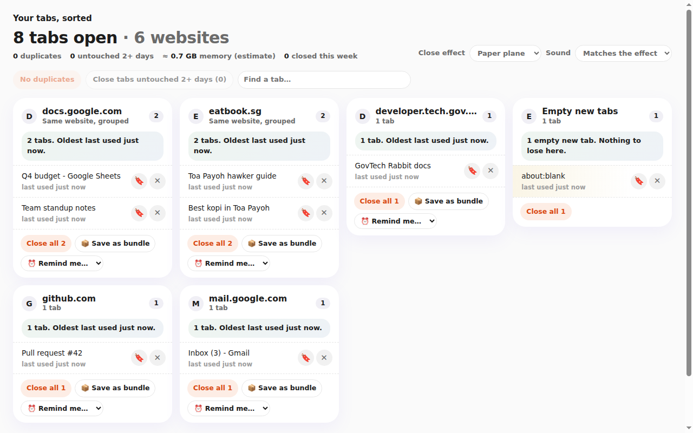

# TabDeck skill

A Claude (and Codex) skill that builds **your own** TabDeck: a Chrome new-tab page that turns your open tabs into one-click cards, with daily news and a 3-minute lesson. Answer a few questions, get a ready-to-install zip, or grab the ready-made "just the tabs" version below.

TabDeck turns your Chrome new-tab page into something useful: your open tabs as cards you can close in one click, today's news from sources you pick, and a 3-minute lesson in whatever you're learning. This skill lets Claude build **your own** TabDeck: it asks you a few questions, writes your lessons, and gives you a ready-to-install zip.

## Just want to try it? (no Claude needed)

**[Download TabDeck-just-tabs.zip](https://github.com/Cheriezy1013/tabdeck-skill/raw/main/TabDeck-just-tabs.zip)**: a ready-made TabDeck that does one job, your open tabs as cards you can close in one click. No news, no lessons, no sign-up.

1. Unzip it and keep the `TabDeck` folder somewhere it will stay, e.g. Documents.
2. Open `chrome://extensions` (Edge: `edge://extensions`), turn on **Developer mode**.
3. Click **Load unpacked** and choose the `TabDeck` folder. Open a new tab.

Works in Chrome, Edge, Brave, Arc, Opera and Vivaldi on a computer. Use your own computer: work laptops often block **Load unpacked**.



Want your own version with your colours, your news and a daily 3-minute lesson? Use the skill below.

## What you need

- A Claude plan that supports skills (Pro, Max, Team or Enterprise), with **code execution** turned on
- A desktop browser built on Chrome: Chrome, Edge, Brave, Arc, Opera or Vivaldi (see below)
- About 10 minutes

## Which browsers work

TabDeck runs in desktop browsers built on Chrome (Chromium). It does not run in Firefox, Safari or on phones.

| Browser | Works? | Extensions page |
|---|---|---|
| Google Chrome | ✅ Yes | `chrome://extensions` |
| Microsoft Edge | ✅ Yes | `edge://extensions` |
| Brave, Arc, Opera, Vivaldi | ✅ Should work (built on Chrome, not tested one by one) | `brave://extensions`, `opera://extensions`, `vivaldi://extensions`; Arc: Extensions in its menu |
| Firefox | ❌ No | |
| Safari | ❌ No | |
| Phone or tablet (any browser) | ❌ No: mobile browsers don't let extensions replace the new-tab page | |

## 1. Add the skill to Claude (once)

1. Download **`tabdeck.zip`** ([direct download](https://github.com/Cheriezy1013/tabdeck-skill/raw/main/tabdeck.zip), or click `tabdeck.zip` in the file list above and then the download button). Don't unzip it.
   (The green "Code → Download ZIP" button gives a different file that Claude won't accept.)
2. In Claude, go to **Settings → Capabilities**. Make sure **Code execution** is on.
3. Under **Skills**, click **Upload skill** and choose `tabdeck.zip`.
4. Turn the TabDeck skill on in your Skills list.

On a Team or Enterprise plan, your admin may need to allow skills first.

### Using Codex instead of Claude

The skill uses the shared `SKILL.md` format, so it also works in OpenAI Codex (CLI, IDE extension or app). You need `git` and Python 3 on your computer.

```bash
git clone https://github.com/Cheriezy1013/tabdeck-skill.git
mkdir -p ~/.agents/skills
cp -R tabdeck-skill/tabdeck ~/.agents/skills/
```

Restart Codex, then say **"Make me a TabDeck"**. Codex asks the same four questions in chat and builds the zip in your current folder. The steps below are the same from here on; wherever it says Claude, read Codex.

## 2. Ask Claude to make your TabDeck

Start a new chat and say something like **"Make me a TabDeck"**. Claude asks four quick questions:

| Question | Examples |
|---|---|
| Which style? | Korean pastel · Midnight neon · Clean minimal · Kopitiam retro · Forest calm · or your own colour |
| What are you learning? | Korean for a trip in December · Excel for work · Mandarin basics · photography |
| What news in the morning? | AI and tech · business · world news · science · design · a site you already read |
| How should closing tabs feel? | Paper plane with a sound · arcade · quiet fade, no sound |

Claude then writes a week of lessons at your level and sends you `TabDeck-<YourName>.zip`.

## 3. Install your TabDeck in your browser (2 minutes)

1. Unzip it and keep the folder somewhere it will stay, e.g. **Documents**. Chrome loads it from there, so don't move or delete it.
2. Open your browser's extensions page: `chrome://extensions` in Chrome, `edge://extensions` in Edge (others: see the table above).
3. Turn on **Developer mode** (top right).
4. Click **Load unpacked** and choose the folder that contains `manifest.json`.
5. Open a new tab. If Chrome asks whether to keep the new-tab page change, choose **Keep it**.

## 4. Every day

- **New tab = your tabs, sorted.** Cards are grouped by website. ✕ closes one tab, **Close all** closes a card, and there are buttons for all duplicates and tabs you haven't touched in 2+ days. Undo is always offered.
- **🔖 Save for later** closes a tab but keeps it. Your oldest saved page comes back in the top-right card when you have a spare minute.
- **📦 Save as bundle / ⏰ Remind me** closes a whole card and brings it back later, with a desktop notification.
- **Top row**: your news, your 3-minute lesson (tap **Learn now**: three phrases with read-aloud, a try-it, a quick quiz and a daily streak), and something you saved.
- **🎁 Tab Wrapped**: your week in tabs.

## Change it later

Ask Claude again with the skill ("Change my TabDeck to midnight neon and Japanese lessons"). Then on `chrome://extensions`, click **Remove** on the old TabDeck and **Load unpacked** for the new folder. Your saved pages and streak start fresh.

## Privacy

Everything stays on your computer. TabDeck reads only the tabs that are open right now, never your browsing history, and closes a tab only when you press a button. It goes online only to fetch the news headlines you chose.

## Troubleshooting

| Problem | What to do |
|---|---|
| "Upload skill" fails | Upload the zip as downloaded, without unzipping or renaming it. Check that code execution is on. |
| Claude doesn't use the skill | Make sure it's turned on in Settings → Capabilities → Skills, then start a new chat and say "Make me a TabDeck". |
| No "Load unpacked" button | Turn on Developer mode (top right of the extensions page). |
| I use Firefox or Safari | TabDeck doesn't run there. Use Chrome or Edge for it, even if you keep your usual browser for other things. |
| A work laptop blocks Load unpacked | That's your company's policy. Ask IT, or use a personal computer. |
| The news card says it couldn't load | Check your internet connection, or ask Claude to switch to another source. Lessons work offline. |
| New tab still shows Google | Open `chrome://extensions` and check TabDeck is switched on; when Chrome asks about the new-tab page, choose **Keep it**. |

## What's in this repository

| Path | What it is |
|---|---|
| `tabdeck/SKILL.md` | The instructions Claude follows: the questions it asks and how it builds your TabDeck |
| `tabdeck/scripts/build_tabdeck.py` | Turns your answers and lessons into a ready-to-install extension, and checks them first |
| `tabdeck/template/` | The TabDeck Chrome extension itself |
| `tabdeck/references/` | How lessons are written, and the list of news sources |
| `tabdeck/examples/` | An example set of answers and a week of Korean lessons |

To try a build without Claude: `python3 tabdeck/scripts/build_tabdeck.py --answers tabdeck/examples/answers.example.json --lessons tabdeck/examples/lessons.example.json --out .`
